<p align="center"></p>

<p align="center">
  <b>A 3D embodied hospital environment for AI and human agents.</b><br>
  Take histories, examine, order, read results, call consultants, catch staff errors, and get scored like an OSCE.
</p>

<!-- badges:start (npm run badges) -->
<p align="center">
  <a href="CHANGELOG.md"></a>
  <a href="#licence"></a>
  <a href="docs/SETUP.md"></a>
  <a href="docs/cases/README.md"></a>
  
  
</p>
<!-- badges:end -->

<p align="center">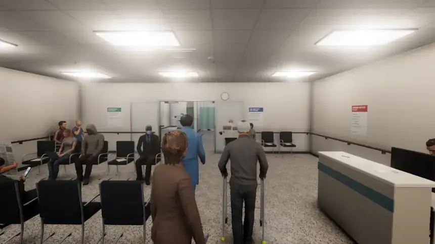</p>

<p align="center">
  <a href="#try-it-in-your-browser">Browser demo</a> &nbsp;·&nbsp;
  <a href="#install-and-play">Install</a> &nbsp;·&nbsp;
  <a href="#controls">Controls</a> &nbsp;·&nbsp;
  <a href="DEVELOPING.md">For developers and researchers</a> &nbsp;·&nbsp;
  <a href="#cite">Cite</a> &nbsp;·&nbsp;
  <a href="CHANGELOG.md">Changelog</a>
</p>

- **Play.** Walk the ED in first person, over the shoulder or top-down. Talk to LLM-powered patients, families, nurses and consultants, by text or by voice.
- **Learn.** Every case has hidden ground truth, evolving physiology, realistic lab turnaround, an EHR with real click-depth, and a debrief with teaching points and references.
- **Watch an AI doctor.** It works in one of two modes. In **clinical actions** mode it chooses from the same actions as a human player (talk, examine, order), and the game walks its avatar. In **embodied** mode it plays from its own game screen: it looks at screenshots, walks with WASD and uses the tablet with mouse and keyboard. Your own agents can play over REST or MCP ([for developers and researchers](DEVELOPING.md)).

Inspired by [AgentClinic](https://arxiv.org/abs/2405.07960) (Schmidgall et al., 2024), but as an open, explorable 3D hospital instead of a turn-based harness.

> **For research purposes only.** Simulated patients and records, not for clinical use or teaching. What exists today is the platform: the cases are a first set and have not yet been validated by clinical experts, so case content and scoring may contain errors. The next step is more cases, of high quality, and we are looking for clinical, engineering and scientific contributors ([how to help](#for-developers-and-researchers)).

## Try it in your browser

The [3D browser demo](https://gtagentclinic.ai/demo/) needs no install and no account. You start in third person in the ED at 22:20. Walk around, talk with the people on shift, examine Robert Keller, read his ECG, and enter a working diagnosis and disposition. Its conversations are scripted, and each visit starts fresh. For LLM conversations, scored shifts and AI doctors, install the full game with the [one-line command below](#install-and-play).

## Install and play

You need [Node.js](https://nodejs.org) 22.12 or newer, git, and Chrome or Edge (best with WebGPU). Then, on macOS or Linux:

```bash
git clone https://github.com/eth-medical-ai-lab/GTAgentClinic.git && cd GTAgentClinic && npm start
```

- **What happens:** `npm start` installs the pinned dependencies (about 200 MB, a few minutes the first time), builds the 3D client and opens the hospital at `http://127.0.0.1:5317`. Press <kbd>Ctrl</kbd>+<kbd>C</kbd> in the terminal to close it.
- **Signing in:** git may ask you to sign in to GitHub. With an SSH key, clone `git@github.com:eth-medical-ai-lab/GTAgentClinic.git` instead.
- **Windows,** first-time terminal users, and every step in detail: [docs/SETUP.md](docs/SETUP.md).
- **Installing safely:** the game runs on your computer like any Node.js project. Install it from this repository and keep it current with `git pull`. [More on installing safely](docs/SETUP.md#installing-safely).

Pick a map, press **Start shift**, and press <kbd>H</kbd> in the game for help.

- **Single case practice:** search the case picker by presenting complaint, specialty, difficulty, diagnosis or case ID.
- **Orientation Day** (easy): two patients to introduce the basic workflow, from taking a history to choosing a disposition.
- **Night Shift** (medium): four patients with different needs. Decide who needs attention first and investigate each case.
- **Mixed Shift:** 12 seeded cases across six staffed bays, with more arriving as beds free up.
- **Full Roster:** every playable case once, with family at the bedside, extra nurses and a busy waiting room.
- **Watch an AI doctor:** an AI resident works the shift. In clinical actions mode you walk the floor as a medical student (press <kbd>T</kbd> to tag along). In embodied mode you watch its own game screen as it plays.

### Who talks for the characters

Use **AI dialogue → Change…** on the title screen to choose a default connection. **Offline** uses scripts for new runs. **Online** allows LLMs. Running shifts keep their connection. The NPC selector below can override the default for one shift. The AI doctor has a separate source control.

| Connection | Setup | Cost |
|---|---|---|
| **Claude Code login** | Install Claude Code, sign in, then approve its use in the game | Uses your Claude login's billing or plan allowance. |
| **Anthropic API** | Set `ANTHROPIC_API_KEY` before starting the server | Billed to your API account. |
| **Codex login** | After package installation, run `npx codex login` in the game folder | ChatGPT login uses plan allowance; API key login uses API billing. |
| **OpenAI API** | Set `OPENAI_API_KEY` before starting the server | Billed separately from a ChatGPT subscription. |
| **Custom API (OpenAI-compatible)** | Enter a server URL and model; set `LOCAL_API_KEY` if required | Depends on your server or hosting provider. |

**No default** keeps NPCs scripted unless a shift selects a connection. Login use requires your consent. Setup steps and model requirements: [model sources](docs/LLM_SOURCES.md).

The ◆ chip shows tokens and costs. Codex shows **estimated API-equivalent costs**, not subscription charges or remaining allowance. OpenAI API shows **estimated API costs**. Unknown prices remain unavailable; cumulative totals can be partial.

> **Your own copy, on your own computer.** GTAgentClinic is open source, and we'd like everyone who uses it to treat it as their own project: run your own build, change it, contribute back. With Claude Code, the game starts your unmodified `claude` program, which handles your login; the game never reads, moves or stores credentials. Your login is for your own play, not for hosting the game for others ([details](docs/SETUP.md#claude-code)).

**Voices.** Turn on 🔊 and every character speaks with your browser's voices. For each character's own neural voice, run `npm run voices:install` once (about 440 MB of packages, plus a 326 MB model on first use). It runs locally on your CPU. See [docs/SETUP.md](docs/SETUP.md#7-voices).

## Solo rotations and save slots

Choose **Save game** during a shift or at the debrief, pick one of five slots, and optionally name it. **Load game** returns to a checkpoint, so you can try a different decision and keep the earlier one.

In solo play you earn XP for eliciting history, examining and returning belongings, and at the debrief for completed cases and personal bests. Souvenirs go into your locker in the Ward 2 East staff lounge (take the east elevators to Floor 2). Pin a missed objective and replay the same seed to improve on it. Saves live in `data/saves/` on your computer.

## Controls

| | |
|---|---|
| <kbd>W A S D</kbd> | Walk. <kbd>Shift</kbd>+<kbd>W</kbd> or double-tap and hold <kbd>W</kbd> runs; <kbd>Space</kbd> jumps |
| Mouse | Look around. **Start shift** captures the mouse; right-click frees the cursor for panels at the screen edges, and right-click again (or click the view, or walk) returns to looking |
| <kbd>E</kbd> | Talk to the person, or use or pick up the thing, in front of you |
| <kbd>F</kbd> / <kbd>G</kbd> | Inspect what you hold / put it down |
| <kbd>V</kbd> | Camera: first person → over the shoulder (scroll to zoom) → top-down (click the floor to walk, click people or objects to use them) |
| <kbd>Tab</kbd> | Your tablet: your patients, and their charts. It frees the mouse, so you can click the buttons on screen, such as the camera. <kbd>Tab</kbd> also tucks an open tablet to the screen edge |
| Hold <kbd>`</kbd> | Speak instead of typing (the key under <kbd>Esc</kbd>; <kbd>§</kbd> on some keyboards) |
| <kbd>Esc</kbd> | Close what's open. With nothing open, open the settings: mouse sensitivity, inverted look, full screen, the keys |
| <kbd>P</kbd> / <kbd>H</kbd> | Pause / help |

**Start shift** goes full screen. Hold <kbd>Esc</kbd> to leave it. In browsers that don't support keyboard lock, the first <kbd>Esc</kbd> leaves full screen. To play in the window, untick full screen in the menu.

Everything lying around can be picked up or inspected, and patients' belongings are clinical clues: what you find in a handbag counts as history taken. Workstations open the AgentChart EHR. The phones at the station reach consultants, the lab, radiology, pharmacy, GP offices, family and insurers.

## Screenshots

| | |
|---|---|
| 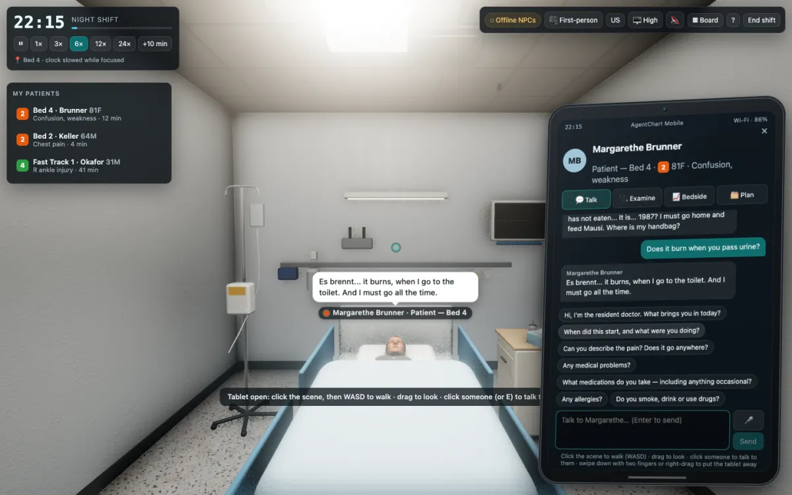 **Talk to anyone.** Patients know only their own symptoms; family and GP offices know what they don't. | 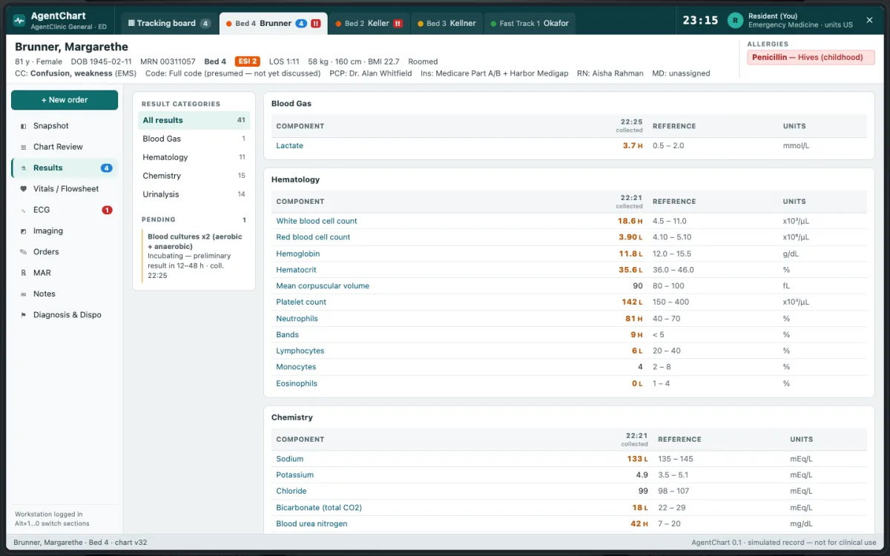 **AgentChart EHR.** Results with trends, flowsheet, a 12-lead ECG viewer, order sets and allergy hard stops. |
| 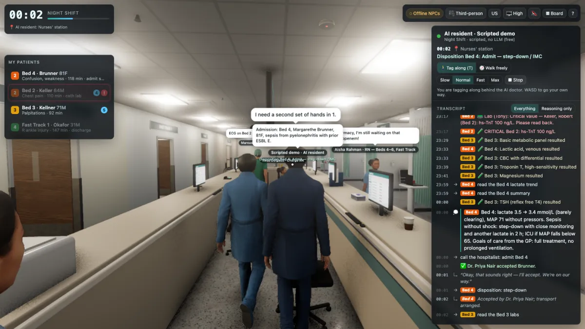 **Watch an AI doctor.** Its reasoning streams into a live teaching transcript. | 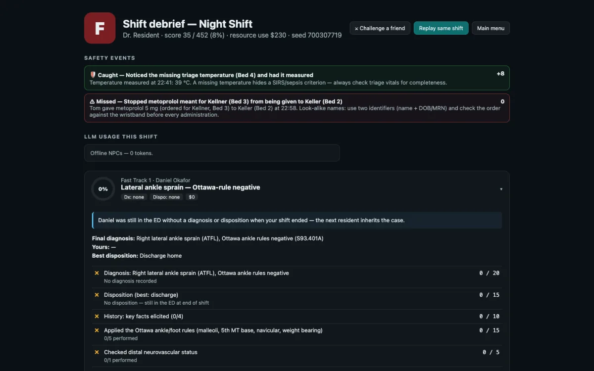 **Debrief.** Critical actions and their timing, harms, low-value tests and safety catches. |
| 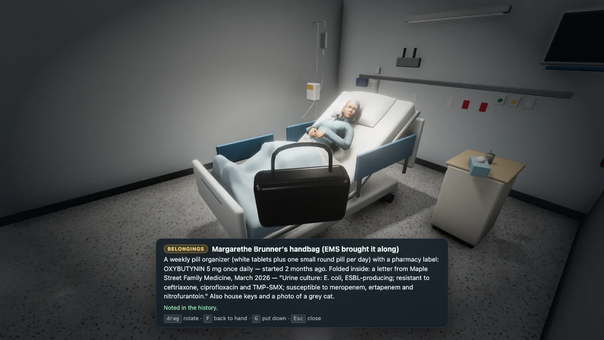 **Everything is a clue.** Belongings count as history taken. | 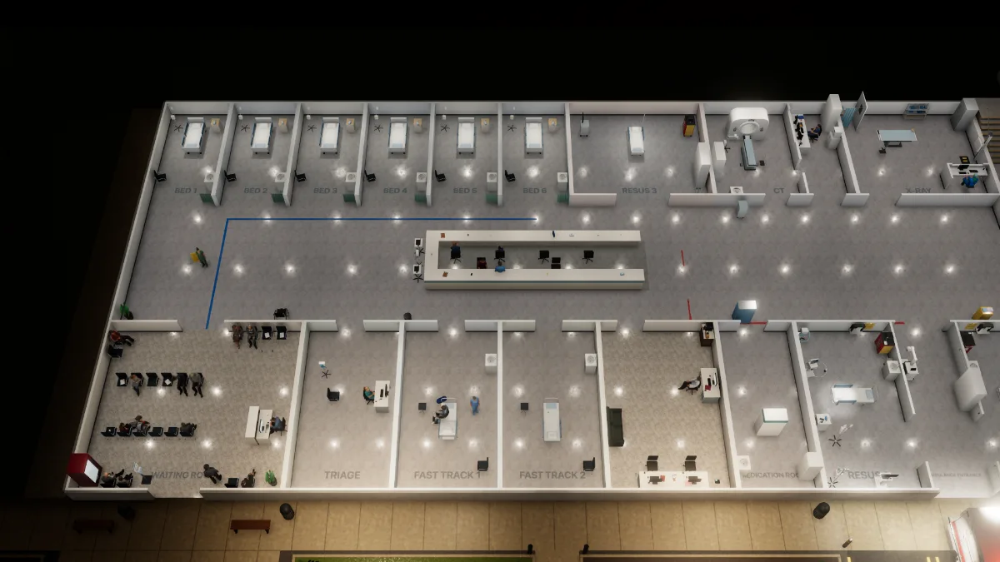 **A real floor plan.** Press <kbd>V</kbd> for a bird's-eye view. |
| 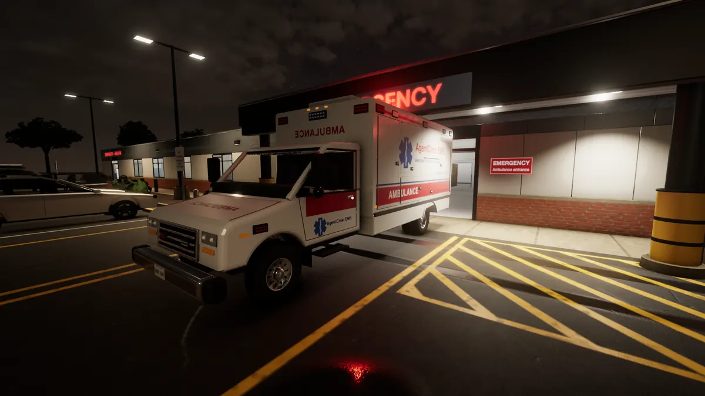 **The ambulance bay at night.** | 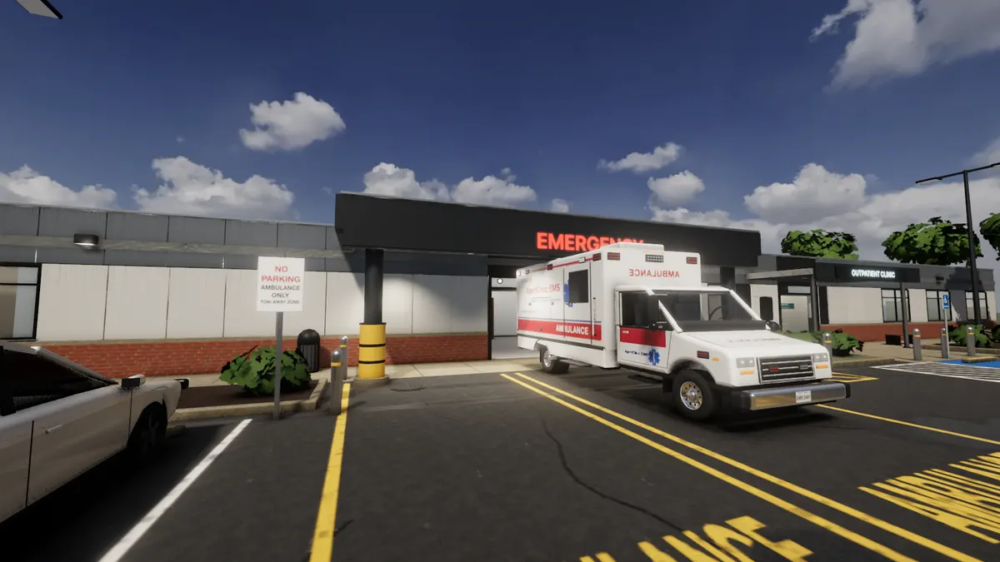 **The same entrance by day.** |
| 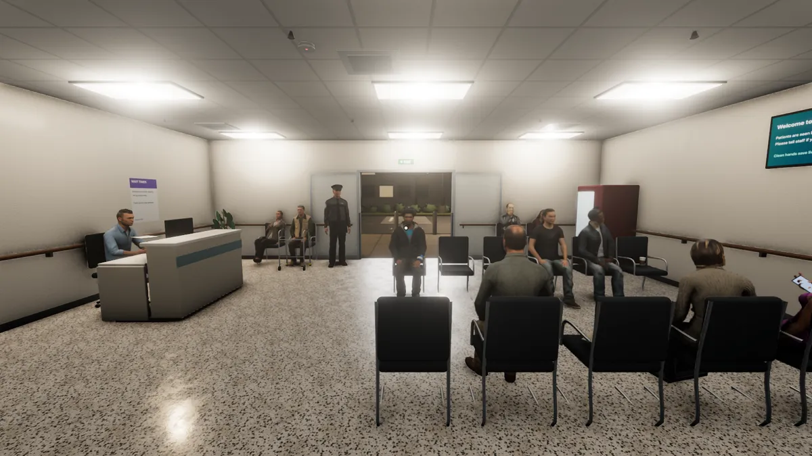 **A waiting room that lives.** Registration, security at the door, a dozen people with a reason to be there. | 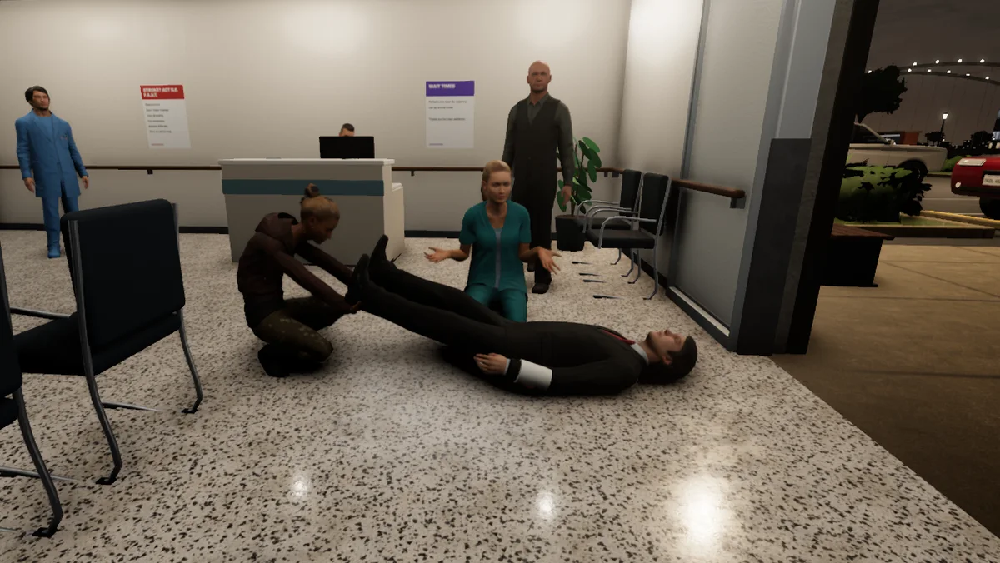 **Now and then, someone faints at the door.** |

<details>
<summary><b>Everything in the game</b></summary>

- **Graphics**
  - Physically based rendering on WebGPU (WebGL 2 fallback): a real light behind every ceiling fixture, ambient occlusion, bloom, temporal anti-aliasing, and soft shadows over the beds.
  - Photo-scanned CC0 materials, realistic motion-captured people (Microsoft Rocketbox), faces with eye contact and mouths that follow the words, and first-person hands and forearms.
  - An outside that holds up by day and night: a detailed Type III ambulance, a rain-wet parking lot whose puddles mirror the EMERGENCY sign, and a town around the hospital campus.
  - A 🖥 HUD button switches Low / Medium / High / Ultra, auto-detected on first run. Best in a WebGPU browser (Chrome, Edge, Safari 26+). See [art direction](docs/ART_DIRECTION.md).
- **NPCs**
  - Patients know only their own symptoms, in lay terms. Family and GP offices know things the patient doesn't.
  - Nurses carry out verbal orders and push back on unsafe ones. The attending teaches Socratically.
  - Consultants accept only when the chart supports it (server-side guards). Insurers deny an MRI for an acute sprain.
  - The waiting room lives: walk-ins with an ice pack, a mask or a walker, quiet small talk, the triage nurse calling names, a small dog in a carrier, and now and then a faint at the door. It runs on its own random stream and is invisible to AI agents and scoring.
- **AgentChart EHR**
  - Tracking board, chart review, results with trend graphs, vitals flowsheet, a procedurally drawn 12-lead ECG viewer with signing, imaging reports, notes, MAR.
  - Order entry with order sets, and allergy hard stops with override reasons. US or SI units.
  - Discharge: signing **Discharge home** starts paperwork; the nurse reviews the instructions at the bedside before the patient walks out or leaves with a wheelchair escort.
- **Simulation**
  - Physiology driven by disease drift and treatment effects (onset, ramp, wear-off).
  - Realistic lab turnaround times, imaging transport, and pregnancy-test holds before CT.
  - Pharmacy verification, nurse and tech task queues, critical-value calls and deterioration pages.
- **Staff errors** you can catch: an incomplete triage set (missing temperature), antibiotics hung before cultures, and the right drug given to the wrong patient (look-alike names).
- **Scoring**
  - Diagnosis, disposition, key history elicited, critical actions and their timing (door-to-ECG, door-to-cath-lab activation, the sepsis hour-1 bundle), harms, low-value tests, safety catches.
  - Debrief with outcomes, timeline, teaching points and guideline references. "Challenge a friend" sends the same seed, so the same shift.
- **Cases:** 111 playable cases. 81 are fiction written for the game; 30 are adapted from open-access case reports. Each [case sheet](docs/cases/README.md) records its origin, authoring method and clinical review status.
- **Case library:** 51 emergency cases with 177 questions, each adapted from one open-access case report (50 CC BY 4.0, 1 CC BY 3.0). Core facts are traced by 1,582 verbatim quotes, which the tests check against the source's full text, and anything added for realism is flagged. See [docs/CASE_LIBRARY.md](docs/CASE_LIBRARY.md).
- **Soundscape:** positional and muffled by walls. Monitors beep with each QRS, pitched by SpO₂, with IEC 60601-1-8 alarm tones. Room tone, phones, printers, pumps, footsteps, doors, overhead pages, the waiting-room TV, sirens, and a public-domain classical radio at the station. The HUD 🎚 button sets the level. See [docs/DESIGN.md](docs/DESIGN.md#soundscape).

</details>

## Troubleshooting

| Problem | Fix |
|---|---|
| `GTAgentClinic needs Node.js 22.12 or newer` | Install the current LTS from [nodejs.org](https://nodejs.org), then open a **new** terminal. |
| Blank or slow 3D view | Chrome or Edge with hardware acceleration on; pick Low or Medium with the 🖥 button, or open `/?quality=low`. Firefox and Chrome on Linux may run the WebGL 2 fallback. |
| I can't click the panels at the screen edge | Right-click to free the cursor. Right-click again to look around. |
| NPCs stay "Offline" after setting a key | Set the matching key in the server terminal, restart, then choose the connection under **AI dialogue → Change…**. |
| "Watch an AI doctor" refuses Claude | Expected until [you choose your Claude Code login](docs/SETUP.md#claude-code). Watch the scripted demo instead. |
| Port 5317 is busy | Nothing to do: the game picks the next free port and prints it. Or choose one: `npm start -- --port 6000`. |
| Voices are silent | Check 🔊 and that the tab isn't muted. With neural voices, the first use downloads ~326 MB (progress in the terminal); or start with `--tts browser`. |
| The first-run question doesn't come | It only asks in a terminal while nothing is chosen. Use **AI dialogue → Change…** to select a connection. |

More in [docs/SETUP.md](docs/SETUP.md#troubleshooting).

## For developers and researchers

[DEVELOPING.md](DEVELOPING.md) covers running from source, the project layout, AI doctors over MCP and REST, research use (seeds, step mode, run logs), and the security model. To contribute a case, a feature or a fix, start with [CONTRIBUTING.md](CONTRIBUTING.md) and the [roadmap](docs/ROADMAP.md).

| If you are… | Add | Start here |
|---|---|---|
| **A clinician** | **New cases:** from the 51 published case reports in the library, or your own teaching cases. **Clinical review:** of cases, scoring and the open questions on infection control. | [New cases](docs/ROADMAP.md#1-new-cases) · [Checkpoints](docs/ROADMAP.md#3-evaluation-deeper-checkpoints) · [Cases at scale](docs/ROADMAP.md#7-future-work-clinicians-adding-cases-at-scale) |
| **A researcher** | **Standardized experiments:** humans and LLM agents on the same seeded cases. **Evaluation:** deeper checkpoints, a communication judge. **Agents:** at the spatial and embodied levels. | [Experiment E0](docs/ROADMAP.md#4-standardized-experiments-humans-and-llm-agents-on-the-same-cases) · [Agent control](docs/ROADMAP.md#5-how-agents-steer-the-doctor) |
| **A developer** | **Patient flow:** admission, handoff, transport to the ward. **Also:** new features, visual realism, performance. | [Patient flow](docs/ROADMAP.md#2-patient-flow-admission-and-beyond) · [Known issues](docs/ROADMAP.md#6-visual-realism-and-known-issues) |

## Licence

- **Code, documentation and assets made for this project:** [Apache License 2.0](LICENSE). Use, change and share them, also commercially. Copies must keep the licence and the [NOTICE](NOTICE) file, and say which files were changed.
- **Clinical cases** (`content/cases/`, `content/library/`, `docs/cases/`, `docs/library/`): [CC BY 4.0](LICENSE-CASES). Share and adapt them, also commercially, and credit them as given in [NOTICE](NOTICE). Cases adapted from a published case report also credit that report's authors; each case records its source.
- **Third-party material keeps its own licence:** characters and motion capture from [Microsoft Rocketbox](https://github.com/microsoft/Microsoft-Rocketbox) (MIT), textures from [ambientCG](https://ambientcg.com) (CC0), skies from [Poly Haven](https://polyhaven.com) (CC0), the station radio from [The Open Goldberg Variations](https://opengoldbergvariations.org), performed by Kimiko Ishizaka (CC0), voices from [Kokoro-82M](https://huggingface.co/hexgrad/Kokoro-82M) (Apache-2.0, downloaded on first use), and rendering with [three.js](https://threejs.org) (MIT). The full list, including npm packages: [THIRD_PARTY_NOTICES.md](THIRD_PARTY_NOTICES.md).
- Inspired by AgentClinic: Schmidgall S, et al. *AgentClinic: a multimodal agent benchmark to evaluate AI in simulated clinical environments.* [arXiv:2405.07960](https://arxiv.org/abs/2405.07960) (2024).

## Cite

If you use GTAgentClinic or its cases in your work, please cite it. The reference matches [CITATION.cff](CITATION.cff), which also feeds GitHub's **Cite this repository** button.

```bibtex
@software{gtagentclinic,
  author = {Moor, Michael and Indrakanti, Ashraya and Kassraie, Arghavan and Balfour, Jamie and Lieberwirth, Johann},
  title = {{GTAgentClinic}: a 3D embodied hospital environment for AI and human agents},
  year = {2026},
  version = {0.3.0},
  url = {https://github.com/eth-medical-ai-lab/GTAgentClinic}
}
```
